 

**Informatics Graduate (Data Science Concentration)  ·  BNSP-Certified Data Analyst** 
Jakarta, Indonesia

---

## About Me

I turn messy, raw data into clear insights that support decisions. I hold a Bachelor of Computer Science (S.Kom) in Informatics with a Data Science concentration from Universitas Mercu Buana. I trained as a Data Analyst at PPKD Jakarta Selatan and built machine learning projects through the IDCamp AI Engineer bootcamp.

| | |
|---|---|
| **Focus** | Data analysis, ETL, data cleaning, dashboards, and reporting |
| **Education** | S.Kom Informatics (Data Science), Universitas Mercu Buana, GPA 3.58/4.00 (Honors) |
| **Certification** | BNSP Data Analyst Competency Certification |
| **Training** | PPKD Jakarta Selatan (Data Analyst) and IDCamp (AI Engineer Bootcamp) |
| **Looking for** | Data Analyst roles |

---

## What I Work With

<table>
  <tr>
    <th align="left">Data Analysis & BI</th>
    <th align="left">Python & Machine Learning</th>
    <th align="left">Tools & Web</th>
  </tr>
  <tr>
    <td valign="top">
      SQL (PostgreSQL, MySQL) 
      Power BI, Looker Studio 
      ETL and data cleaning 
      Exploratory data analysis 
      KPI reporting
    </td>
    <td valign="top">
      Pandas, NumPy 
      Scikit-Learn, TensorFlow 
      Time series forecasting 
      NLP and sentiment analysis 
      Computer vision
    </td>
    <td valign="top">
      Git and GitHub 
      HTML, CSS, JavaScript 
      WordPress
    </td>
  </tr>
</table>

---

## Featured Projects

| Project | Domain | What it does | Tech |
|---|---|---|---|
| **Banking Customer Experience Analytics (BCXA)** | NLP | Sentiment analysis system for BRImo mobile app reviews, reaching 93.58% accuracy | Python, TensorFlow, Bi-GRU + Attention |
| **Bitcoin Hourly Price Prediction** | Time Series | Forecasts Bitcoin prices hour by hour with a custom deep learning model | Python, TensorFlow, LSTM |
| **Automated Brand Recognition System (ABRS)** | Computer Vision | Image classification model that recognizes English Premier League club logos | Python, TensorFlow, CNN |
| **'Cek Bansos' Sentiment Analysis (Thesis)** | NLP | Performance comparison of RNN-LSTM and Random Forest on app review sentiment | Python, Scikit-Learn, TensorFlow |

---

## Tech Stack

---

## Education & Training

- **Universitas Mercu Buana**: S.Kom, Informatics (Data Science), 2019–2024, GPA 3.58/4.00 (Honors)
- **PPKD Jakarta Selatan**: Data Analyst Training Program (Intensive), 2026
- **IDCamp (Indosat Ooredoo Hutchison)**: AI Engineer Bootcamp (Scholarship), 2025–2026
- **BNSP**: Data Analyst Competency Certification

---

### Let's Connect

I'm looking for a **Data Analyst** role where I can turn data into decisions. 
Reach me on [LinkedIn](https://linkedin.com/in/rudywijayaa) or at **wijayarudy99@gmail.com**.

